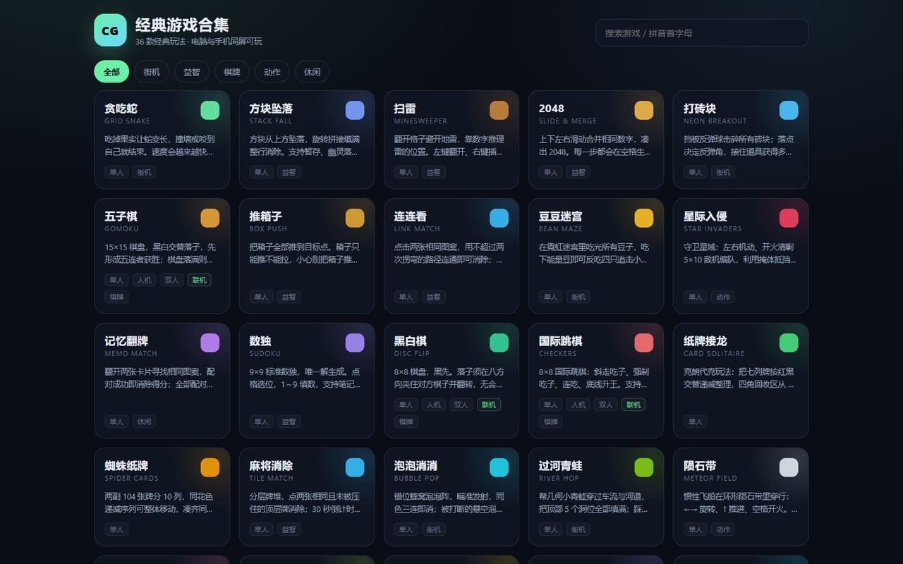

<div align="center">

# 经典游戏合集

**36 款经典玩法 · 一个门户 · 电脑与手机同一套代码** · 纯前端 · 无框架 · 可装进飞牛 NAS 应用中心

[](#游戏清单)
[](#质量)
[](#技术栈)



</div>

---

## 这是什么

36 款经典小游戏共用一套外壳（菜单、暂停、结算、存档、音效、输入映射），
每款游戏只写自己的规则与渲染。门户页按分类浏览、可按名称/拼音搜索。

**PC 与手机是同一套代码**：布局、触屏操控、触控目标尺寸都由 `shared/` 统一处理，
游戏本身不感知设备类型。

除了纯前端形态，它还打包成**飞牛 fnOS 原生应用**（`.fpk`），可以直接装在 NAS 上，
通过端口访问或经 fnOS 统一网关从 `/app/classic-games` 进入。

## 游戏清单

### 街机（7 款）

| 游戏 | 英文名 | 玩法 | 模式 |
| --- | --- | --- | --- |
| **贪吃蛇** | Grid Snake | 吃掉果实让蛇变长，撞墙或咬到自己就结束。速度会越来越快，可切换穿墙模式。 | 单人 |
| **打砖块** | Neon Breakout | 挡板反弹球击碎所有砖块；落点决定反弹角，接住道具获得多球、加宽或慢球。 | 单人 |
| **豆豆迷宫** | Bean Maze | 在霓虹迷宫里吃光所有豆子，吃下能量豆即可反吃四只追击小精灵。 | 单人 |
| **泡泡消消** | Bubble Pop | 错位蜂窝泡泡阵，瞄准发射，同色三连即消；被打断的悬空泡泡整片坠落，连消加倍。每发之后顶棚还会落下一行。 | 单人 |
| **过河青蛙** | River Hop | 帮几何小青蛙穿过车流与河道，把顶部 5 个洞位全部填满；踩住原木过河，3 条命、每关 30 秒。 | 单人 |
| **乒乓对决** | Pong Duel | 上方与下方各守一拍，接球落点决定反弹角，先得 11 分者获胜。 | 单人 / 人机 / 同屏双人 / 联机 |
| **空气曲棍球** | Air Hockey | 竖屏球桌上下各守一拍，圆盘在桌上高速反弹，把球打进对方球门，先到 7 分获胜。 | 单人 / 人机 / 同屏双人 / 联机 |

### 益智（10 款）

| 游戏 | 英文名 | 玩法 | 模式 |
| --- | --- | --- | --- |
| **方块坠落** | Stack Fall | 方块从上方坠落，旋转拼接填满整行消除。支持暂存、幽灵落点与硬降，堆到顶即结束。 | 单人 |
| **2048** | Slide & Merge | 上下左右滑动合并相同数字，凑出 2048。每一步都会在空格生成新数字，走错可以撤销一步。 | 单人 |
| **扫雷** | Minesweeper | 翻开格子避开地雷，靠数字推理雷的位置。左键翻开、右键插旗，数字格旗数够了可和弦展开。 | 单人 |
| **连连看** | Link Match | 点击两张相同图案，用不超过两次拐弯的路径连通即可消除；边界外也可绕行一圈。 | 单人 |
| **数独** | Sudoku | 9×9 标准数独，唯一解生成。点格选位，1～9 填数，支持笔记候选、提示、错误高亮与撤销。 | 单人 |
| **麻将消除** | Tile Match | 分层牌堆，点两张相同且未被压住的顶层牌消除；30 秒倒计时，每消一对 +3 秒，全部消完通关。 | 单人 |
| **推箱子** | Box Push | 把箱子全部推到目标点。箱子只能推不能拉，小心别把箱子推到死角。 | 单人 |
| **管道连接** | Pipe Link | 点击旋转管道，让水从水源流到所有终点。支持 5×5 / 6×6 / 7×7 难度。 | 单人 |
| **数织** | Nonogram | 10×10 网格旁给出每行每列连续填充段的数字（如 3,1 表示两段 3 格与 1 格，段间至少空一格）。点格填充、再点取消，长按或右键标 X 排除，全部填充与原图一致即胜。 | 单人 |
| **方块对战** | Block Duel | 两场方块各自坠落，消行给对手送垃圾行：垃圾行带一个缺口、塞到底部把整堆顶起来，先被顶出盘面者负。 | 单人 / 人机 / 同屏双人 / 联机 |

### 棋牌（6 款）

| 游戏 | 英文名 | 玩法 | 模式 |
| --- | --- | --- | --- |
| **五子棋** | Gomoku | 15×15 棋盘，黑白交替落子，先形成五连者获胜；棋盘落满则和棋。支持人机、同屏双人与联机。 | 单人 / 人机 / 同屏双人 / 联机 |
| **黑白棋** | Disc Flip | 8×8 棋盘，黑先。落子须在八方向夹住对方棋子并翻转，无合法着法自动跳过，终局子多者胜。支持人机、同屏双人与联机。 | 单人 / 人机 / 同屏双人 / 联机 |
| **国际跳棋** | Checkers | 8×8 国际跳棋：斜走吃子、强制吃子、连吃、底线升王。支持人机、同屏双人与联机。 | 单人 / 人机 / 同屏双人 / 联机 |
| **中国象棋** | Chess Classic | 9×10 棋盘、楚河汉界：车马炮象士将全套走子规则，含将军/应将/绝杀/困毙。支持人机、同屏双人与联机。 | 单人 / 人机 / 同屏双人 / 联机 |
| **飞行棋** | Race Board | 红蓝各 4 子从基地出发，绕 52 格环道一圈再进 6 格终点跑道。掷出点数走子，踩到对手的非安全格棋子把它撞回基地，6 点再掷一次；4 子先全部到终点者胜。 | 单人 / 人机 / 同屏双人 |
| **蛇梯棋** | Snakes & Ladders | 10×10 蛇形棋盘，掷骰前进；踩到梯子向上冲，踩到蛇滑下去，恰好停在 100 才获胜。 | 单人 / 人机 / 同屏双人 |

### 休闲（5 款）

| 游戏 | 英文名 | 玩法 | 模式 |
| --- | --- | --- | --- |
| **记忆翻牌** | Memo Match | 翻开两张卡片寻找相同图案，配对成功即消除得分；全部配对完成即获胜。三档难度可选，支持撤销。 | 单人 |
| **敲地鼠** | Whack a Mole | 30 秒内敲中随机冒出的地鼠，连击越高加分越多，漏掉会断连击。 | 单人 |
| **单键飞行** | One-Key Fly | 点击或按键给出向上冲量，控制发光飞行器穿过光栅；撞管道或边界即结束，速度随分数略增。 | 单人 |
| **蓄力跳** | Power Jump | 按住蓄力、松开起跳，飞向下一个平台；力度决定水平速度，落在平台中心触发完美加成，掉下屏幕即结束。 | 单人 |
| **24 点** | Make 24 | 发四张数字牌，用加减乘除与括号把它们凑成 24。每张牌恰好用一次，能凑出多解更好。 | 单人 / 同屏双人 |

### 动作（5 款）

| 游戏 | 英文名 | 玩法 | 模式 |
| --- | --- | --- | --- |
| **星际入侵** | Star Invaders | 守卫星域：左右机动、开火清剿 5×10 敌机编队，利用掩体抵挡敌弹，撑过一波波加速进攻。 | 单人 |
| **陨石带** | Meteor Field | 惯性飞船在环形陨石带里穿行：←→ 旋转、↑ 推进、空格开火。大石裂中石、中石裂小石，清空一波更凶。 | 单人 |
| **坦克战场** | Tank Arena | 在 13×13 的钢铁与砖墙阵地里驾驶坦克，击毁全部敌车过关，3 条命、子弹可互消。 | 单人 / 人机 / 同屏双人 / 联机 |
| **贪吃蛇大作战** | Snake Battle | 2～4 条蛇同场：吃散落食物变长加速，绕圈围杀对手；撞墙、撞自己或撞到别人的身体就出局，身体全部变成食物。最后存活者获胜，90 秒到按体长判。 | 单人 / 人机 / 同屏双人 / 联机 |
| **爆破迷宫** | Blast Maze | 在钢柱与砖墙的迷宫里布雷：2 秒引信、十字火焰，炸毁砖墙、清光敌人，砖后还藏着道具。 | 单人 |

### 纸牌（3 款）

| 游戏 | 英文名 | 玩法 | 模式 |
| --- | --- | --- | --- |
| **纸牌接龙** | Card Solitaire | 克朗代克玩法：把七列牌按红黑交替递减整理，四角回收区从 A 到 K 同花色堆叠，全部回收即获胜。 | 单人 |
| **蜘蛛纸牌** | Spider Cards | 两副 104 张牌分 10 列，同花色递减序列可整体移动，凑齐同花色 K→A 十三张自动收走，收满 8 组即胜。 | 单人 |
| **空当接龙** | Free Cell | 一副牌全翻开分 8 列，靠 4 个自由格周转，把 52 张按花色 A→K 收进 4 个基础堆。 | 单人 |

## 质量

```bash
node --test "games/*/tests/*.test.mjs"     # 560 条，全绿
```

每款游戏都有 `tests/`，覆盖各自的核心规则：胜负判定、合法走法、计分、
AI 出招合法性、渲染不抛异常等。棋类（五子棋/黑白棋/国际跳棋/中国象棋/飞行棋/蛇梯棋）
的 AI 是纯函数，可在不开浏览器的情况下断言。

## 技术栈

| | |
| --- | --- |
| 前端 | 原生 ES Module + Canvas 2D，**零框架、零构建**（不需要 webpack/vite） |
| 共享层 | `shared/` —— 引擎循环、输入映射、HUD、存储、音频、RNG、主题样式 |
| 服务 | Node 原生 `http` + `ws`，无框架 |
| 打包 | `scripts/build.mjs` 收拢 → `build/www/` → `fnpack` 打成 `.fpk` |
| 运行环境 | 浏览器；NAS 上需要 fnOS 的 Node.js v24 运行时 |

**没有用任何前端框架**：36 款游戏每款只有几百行，引入框架只会让「打开文件就能读懂」
变成「先学一遍框架」。

## 怎么跑

```bash
npm install                      # 只有一个依赖：ws（联机用）
node scripts/build.mjs           # 构建 + 自检 → build/www/
PORT=8101 node platform/server/index.mjs
```

打开 `http://127.0.0.1:8101/` 就是门户页。

跑单测：

```bash
node --test "games/*/tests/*.test.mjs"
```

## 目录

```text
.
├── games/<id>/            每款游戏：game.json + 源码 + tests/（自包含）
├── shared/                共用引擎、输入、HUD、存储、音频、RNG、样式
├── platform/
│   ├── portal/            门户页
│   ├── server/index.mjs   静态服务 + 网关前缀 + WS
│   └── manifest.mjs       36 款清单（唯一事实来源）
├── scripts/               build / pack / deploy
├── packaging/fnapp/       fnOS 包骨架（manifest、cmd 生命周期、图标、向导）
└── docs/screenshots/      截图
```

新增一款游戏 = 建 `games/<id>/`（照 `.agents/constraints/game-contract.md` 的契约）
+ 在 `platform/manifest.mjs` 加一行。门户、构建、打包都从清单读，不另处维护。

## 设计上的一些取舍

**为什么共用外壳而不是每款各写一套**：36 款游戏如果各自实现菜单、暂停、结算、
存档，就是 36 份会各走各的「半成品 UI」。共用外壳后，加一款游戏只需实现
`init/update/render` 与规则，UI 一致性由外壳保证。

**为什么游戏自包含**：`games/<id>/` 里只有这款游戏需要的东西，改一款不会碰到另一款。
`shared/` 由平台侧统一改，游戏不各自 fork。

**为什么零构建**：浏览器原生支持 ES Module 已经很多年了，36 款游戏的体量用不上
打包器。少一层构建，改完刷新生效，调试路径最短。

## 移动端

每款游戏都有触屏方案：滑动转向、屏幕虚拟键、点击/长按区分。验收用无头浏览器在
375×812 / 844×390 / 1440×900 三个视口逐个截图并检查控制台报错。

## 第三方素材与许可

- 所有美术、音效均为**运行时程序化生成**（Canvas 绘制 + Web Audio 合成），
  仓库里没有一张图片、一个音频文件。
- 36 款玩法都是从公开规则重新实现的，**不含任何原作的美术、音频或关卡数据**；
  游戏名只复刻玩法，不复刻原名与角色（例如国际跳棋不叫 Checkers 的商标名）。

**本仓库代码暂未授予开源许可**（All rights reserved）。如需复用某部分，请先联系作者。
