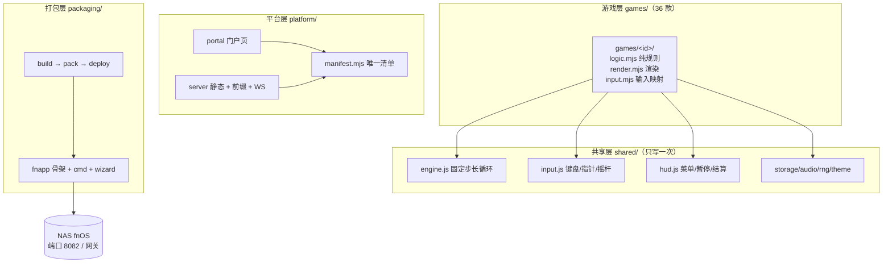
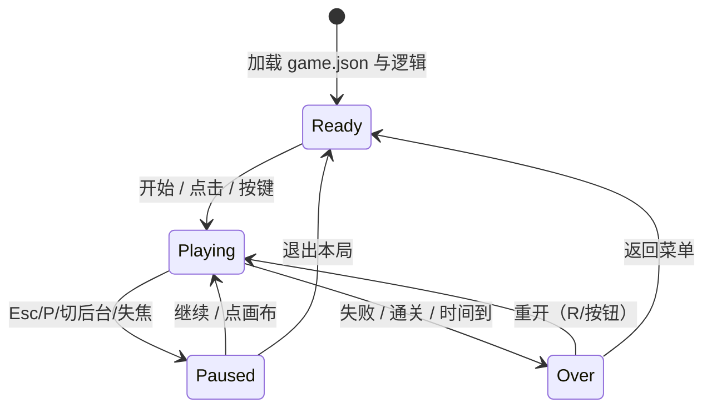
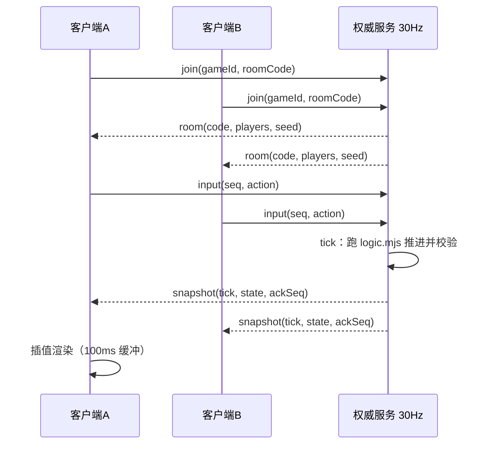
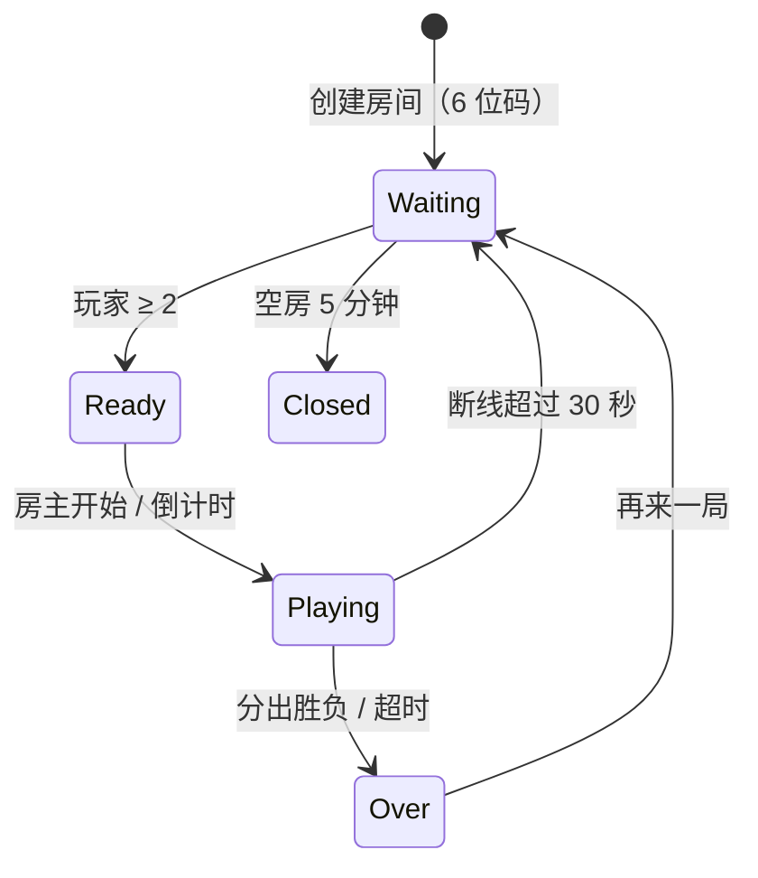
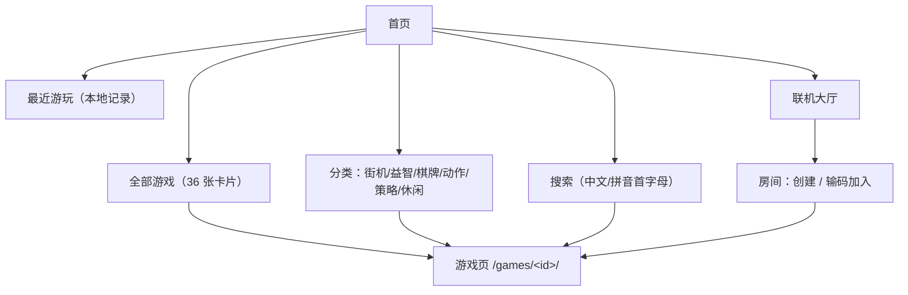
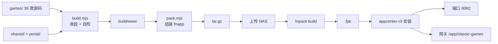
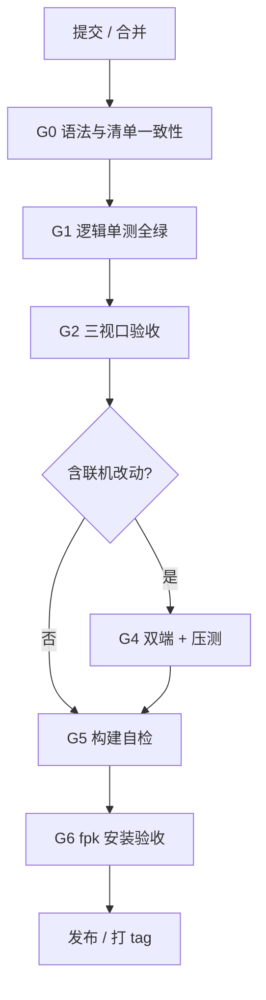
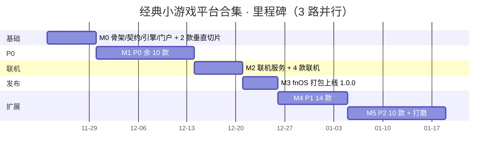
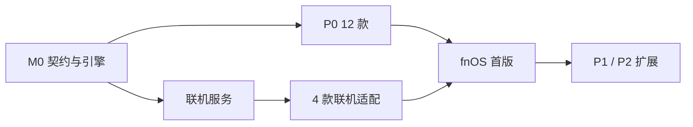

# 经典小游戏平台合集 · 设计与实施计划书

- 版本：v1.0
- 日期：2026-11-18
- 作者：潘云孟
- 状态：**待评审**（P0 范围、联机首期 4 款、应用命名三处需确认，见第 13 节）

---

## 0. 结论摘要

做一个**浏览器即开、电脑与手机同一套代码、装在飞牛 NAS 应用中心里的经典小游戏合集**。
单仓库 monorepo，36 款候选游戏（P0 12 / P1 14 / P2 10），原生 JS + Canvas 2D，零框架；
统一引擎与游戏契约让「多一款游戏」的边际成本压到 1.5～3 人日；联机走权威服务器 + 30 Hz tick，
首期落地五子棋、乒乓、坦克、贪吃蛇对战 4 款；最终打成 fnOS 应用 `classic-games`，
端口 8082 + 统一网关 `/app/classic-games` 双入口。

| 项 | 结论 |
| --- | --- |
| 产品形态 | Web 应用（桌面浏览器 / 手机浏览器），无安装、无账号 |
| 代码组织 | 单仓库：`platform/` + `games/<id>/` + `shared/` + `packaging/` |
| 游戏数量 | 36 款候选；首版上 12 款 P0，再扩 14 款 P1、10 款 P2 |
| 技术 | 原生 JS（ES Module）+ Canvas 2D + DOM HUD；零框架、零外部资源 |
| 移动端 | 竖屏 375×812 必须完整可玩；横屏 844×390 可用；桌面 1440×900 不退化 |
| 联机 | 同屏双人 + 联机对战；Node 权威服务，30 Hz tick / 15 Hz 快照 |
| 打包 | fnOS 原生应用 `classic-games`，端口默认 8082，网关 `/app/classic-games` |
| 排期 | 3 路并行约 12 周；单线程约 22 周（110 人日） |
| 最大风险 | 版权命名、30+ 款质量参差、联机同步复杂度、fnOS 升级不覆盖 |

---

## 1. 事实与约束

> 本节的每条「事实」都有出处：要么是同目录 `3D游戏合集` 的实测结果，要么是 fnOS / 浏览器
> 的硬约束。方案只从这些事实推导，不靠「别人都这么做」。

### 1.1 已跑通的既有事实（可复用，不是推测）

同目录 `D:\MyProjects\X.AIProjects\3D游戏合集` 已经用 7 款 Three.js 游戏把整条链跑通一次，
以下是可直接继承的事实：

| # | 事实 | 出处 | 对新项目的含义 |
| --- | --- | --- | --- |
| 1 | fnOS 应用必须按 `app/www` + `app/server` 布局，否则 fnpack 静默忽略、装完空白 | [部署-FNOS.md](D:/MyProjects/X.AIProjects/3D游戏合集/3D游戏聚合平台/docs/部署-FNOS.md) | 打包目录照抄，不重新发明 |
| 2 | 一个 Node 进程同时监听 TCP 端口与网关 Unix Socket，用两个 Server 实例共享请求处理 | [server/index.mjs](D:/MyProjects/X.AIProjects/3D游戏合集/3D游戏聚合平台/server/index.mjs) | 直接复用双监听骨架 |
| 3 | 网关请求带 `/app/<appname>` 前缀，服务端必须剥前缀并把前缀回写前端 | 同上 | 子路径部署是硬要求，前端全部相对路径 |
| 4 | `appcenter-cli install-fpk` 升级**不覆盖**已存在文件，必须卸载重装 | 部署文档「踩过的坑」第 7 条 | 发版流程固化「先 uninstall 再 install」 |
| 5 | Windows 打 Linux 包必须用 Python `tarfile` 逐成员写权限位，cmd/ 下 755 | 技能 `fnos-fpk-packaging` | 打包脚本直接复用 |
| 6 | 门户 + 清单（manifest）作为唯一事实来源，构建与 UI 都读它 | [games.manifest.mjs](D:/MyProjects/X.AIProjects/3D游戏合集/3D游戏聚合平台/games.manifest.mjs) | 36 款只维护一份清单 |
| 7 | 移动端三视口自动验收器已存在（含「进对局」脚本表） | [.agents/work/tools/mobile-check.mjs](D:/MyProjects/X.AIProjects/3D游戏合集/.agents/work/tools/mobile-check.mjs) | 扩成 36 款批量门禁 |
| 8 | 统一设计令牌（字体/底色/圆角/键位/文案）能消除「像七个产品」的问题 | [设计语言规范.md](D:/MyProjects/X.AIProjects/3D游戏合集/3D游戏聚合平台/docs/设计语言规范.md) | 直接作为本项目的视觉基线 |
| 9 | `ws` 以 `noServer` 模式挂到多个 listen 实例上，一个 WS 服务服务所有入口 | [server/tank.mjs](D:/MyProjects/X.AIProjects/3D游戏合集/3D游戏聚合平台/server/tank.mjs) | 联机服务按同一模式挂载 |
| 10 | 3D 合集占用了 8081；NAS 上已有应用并存 | 部署文档 | 本项目默认端口取 8082 |

### 1.2 平台约束（fnOS）

| 约束 | 事实 | 强制含义 |
| --- | --- | --- |
| 包结构 | fnpack 只认 `<appname>/{manifest,ICON*.PNG,config,cmd,wizard,app}` | 目录一次定死，不试错 |
| 入口键名 | `app/ui/config` 的键必须以 appname 开头（`classic-games.main`） | 命名先定，后写配置 |
| 端口 | 向导可配；8081 已被 3D 合集占用 | 默认 8082，`checkport=true` |
| 网关 | 统一网关走 `gatewayPrefix` + `gatewaySocket`，转发时保留前缀 | 服务端剥前缀 + 相对路径 |
| 生命周期 | `cmd/main status` 必须同时核对进程 / 端口 / socket 三件事 | status 脚本按技能模板写 |
| 升级 | 覆盖安装保留旧文件 | 每次发版先卸载 |
| 平台 | NAS 为 x86，Node 运行时 `/var/apps/nodejs_v24/target/bin/node` | `platform=x86`，Node ≥ 20 |

### 1.3 浏览器与移动端约束

| 约束 | 事实 | 强制含义 |
| --- | --- | --- |
| `file://` | ES Module 在 `file://` 下被 CORS 拦 | 只承诺「经 HTTP 服务玩」，不做双击即玩（N5） |
| 触屏 | Pointer Events 同时覆盖鼠标/触摸/笔 | 统一用 pointer 事件，不写两套 |
| 触摸手势 | 浏览器默认滚动/缩放会吃掉操作 | 玩法区 `touch-action: none` |
| 动态视口 | 手机地址栏导致 `100vh` 跳变 | 一律 `100dvh` + `env(safe-area-inset-*)` |
| 可点尺寸 | 手指命中率 | 控件 ≥ 44×44 CSS px，间距 ≥ 8 px |
| 横向滚动 | 窄屏最易翻车 | `scrollWidth ≤ innerWidth + 1` 作为硬判据 |
| 外部资源 | 公司网络/离线场景不可依赖 CDN | 零外部字体/图片/JS；美术程序化生成 |
| 性能 | 低端手机 GPU/内存有限 | DPR 上限 2、静态层离屏、热路径零分配 |

### 1.4 本轮用户裁决（2026-11-18）

1. **技术栈与仓库形态**：单仓库 monorepo，`platform/` + `games/<id>/`，原生 JS + Canvas 2D，零框架零外部依赖。
2. **范围**：我出 30+ 款候选池，按 P0/P1/P2 三批；P0 先做 12 款打穿全链路。
3. **在线能力**：加同屏双人 + 联机对战。
4. **交付格式**：Markdown（含 Mermaid 图）。

### 1.5 由约束推导出的 7 条设计决定

| # | 决定 | 来自哪条约束 | 主动放弃/代价 |
| --- | --- | --- | --- |
| D1 | 每款游戏的**纯逻辑**独立成 `logic.mjs`（无 DOM、无随机时钟），客户端与服务端共用 | 联机要防作弊、要确定性 | 逻辑层不能直接摸 canvas/DOM，要传 context |
| D2 | 每款游戏**零构建**：`index.html` + ES Module 直接跑，无打包器 | fnOS 包要小、子路径部署要稳、Windows 打包坑要少 | 不做 tree-shaking；用目录约定控制体积 |
| D3 | 统一 `shared/shell` 承担引擎、输入、HUD、暂停、存储、音频 | 36 款一致性 + 移动端适配不能每款重做 | 单款游戏不能随意改交互框架 |
| D4 | 静态优先：无联机时服务端只发文件；联机由人开关控制 | 包要稳、NAS 资源有限 | 关掉联机时相关入口隐藏（不留死按钮） |
| D5 | 美术全程序化（Canvas/SVG/CSS），零二进制素材 | 版权 + 包体积 + 离线 | 视觉上限受限于程序化风格 |
| D6 | 服务端单进程双监听，不引入 nginx 配置 | fnOS 升级会覆盖系统配置 | 路由/缓存/压缩都要自己写（标准库够） |
| D7 | 验收工具化：每款游戏过三视口 + 逻辑单测 + 联机双端 | 36 款靠肉眼必漏 | 前期多花 1～2 天做工具 |

---

## 2. 目标与非目标

### 2.1 目标

| # | 目标 | 可验证判据 |
| --- | --- | --- |
| G1 | 36 款经典玩法，首版 12 款完整可玩 | 每款能从门户进入、玩完一局、结算、重开 |
| G2 | 电脑/手机同一套代码，手机竖屏完整可玩 | 375×812 竖屏、844×390 横屏、1440×900 桌面三视口全过 |
| G3 | 同屏双人 + 联机对战可用 | 五子棋/乒乓/坦克/贪吃蛇对战 4 款双端实测 |
| G4 | 打成 fnOS 原生应用，双入口可用 | 端口 8082 与网关 `/app/classic-games` 都能进，控制台零报错 |
| G5 | 多一款游戏的边际成本 ≤ 3 人日 | P1/P2 实际工时对照估算表 |
| G6 | 可维护：改一款游戏不影响其它 35 款 | 目录隔离 + 清单驱动 + 单款独立验收 |

### 2.2 非目标（明确不做，防止范围膨胀）

| # | 非目标 | 原因 |
| --- | --- | --- |
| N1 | 账号体系、云存档、跨设备同步 | 无后端账号需求；localStorage 足够 |
| N2 | 排行榜 / 成就 / 内购 | 首版不做；留 `storage` 命名空间，将来可加 |
| N3 | 游戏内聊天 / 好友 / 匹配大厅 | 联机只做「房间码 + 快速加入」 |
| N4 | 3D、WebGL 重渲染、物理引擎库 | 经典 2D 玩法用 Canvas 2D 足够 |
| N5 | 双击即玩的单文件版 | `file://` 下 ES Module 被 CORS 拦；平台本身就是 HTTP 服务 |
| N6 | iOS/Android 原生壳 | 浏览器即玩；需要时再做 PWA 清单 |

---

## 3. 总体架构

### 3.1 分层



### 3.2 目录职责

| 路径 | 作用 | 谁能改 |
| --- | --- | --- |
| `games/<id>/` | 一款游戏的全部代码与测试，自包含 | 该游戏的负责人 |
| `shared/` | 引擎、输入、HUD、存储、音频、设计令牌 | 平台负责人（改动需全量回归） |
| `platform/portal/` | 门户页：卡片、分类、搜索、最近游玩 | 平台负责人 |
| `platform/server/` | 静态服务、前缀剥离、联机房间与权威模拟 | 平台负责人 |
| `platform/manifest.mjs` | 36 款游戏的唯一清单（id/名称/品类/模式/accent/入口） | 平台负责人 |
| `scripts/` | 构建、打包、部署、验收工具 | 平台负责人 |
| `packaging/fnapp/` | manifest、cmd、config、wizard、图标 | 平台负责人 |
| `build/` | 构建产物与 tar 包，**不进 git** | 任何人（可删可重建） |
| `.agents/` | 台账、约束、过程文件，**不进 git 交付** | 本机 |

### 3.3 请求路径

| 入口 | URL | 服务端行为 |
| --- | --- | --- |
| 端口 | `http://<NAS>:8082/` | 前缀为空，直接查 `www/` |
| 端口+前缀 | `http://<NAS>:8082/app/classic-games/` | 按路径识别并剥前缀（兼容手输） |
| 网关 | `https://<NAS>:<网关端口>/app/classic-games` | 剥 `/app/classic-games`，静态 + WS 都走同一路由 |
| 游戏页 | `.../games/<id>/` | 相对路径加载 `../../shared/*`，无绝对路径 |
| 联机 WS | `.../games/<id>/ws` | `noServer` 挂载，按前缀识别 |

---

## 4. 统一游戏契约（Game Contract）

> 这是「尽量多」的地基。36 款游戏必须长成同一种形状，平台才能在不知道具体玩法的前提下
> 提供菜单、暂停、结算、存档、移动端输入与验收。

### 4.1 `game.json`（每款一份，构建与门户都读）

```json
{
  "id": "snake",
  "title": "贪吃蛇",
  "subtitle": "Grid Snake",
  "category": "arcade",
  "modes": ["solo"],
  "inputs": ["keyboard", "swipe", "dpad"],
  "accent": "#6cf0a8",
  "desc": "网格移动、吃食变长、撞墙或穿墙两种规则。",
  "order": 1
}
```

| 字段 | 约束 |
| --- | --- |
| `id` | 小写英文/数字/连字符，必须等于目录名，且全局唯一 |
| `category` | `arcade` / `puzzle` / `board` / `action` / `strategy` / `casual` 六选一 |
| `modes` | `solo` / `local2p` / `online` / `ai` 的任意组合 |
| `inputs` | shell 需要渲染的输入控件类型（决定 HUD 布局） |
| `accent` | 该游戏强调色，只能用 `--accent`，不得改全局底色 |

### 4.2 模块划分：纯逻辑与表现分离

| 文件 | 职责 | 允许依赖 | 单测 |
| --- | --- | --- | --- |
| `logic.mjs` | 规则、状态机、AI、判定；**纯函数/纯类**，无 DOM、无 `Math.random`（注入 RNG）、无 `Date.now` | 无 | ✅ 必测 |
| `render.mjs` | 把状态画到 canvas；只读逻辑状态 | Canvas 2D API | 冒烟 |
| `input.mjs` | 把统一输入事件翻译成该游戏的动作 | `shared/input.js` | 少量 |
| `game.js` | 组装：创建实例、绑定 shell 生命周期、注册 HUD | shared + 上述文件 | — |
| `tests/*.test.mjs` | `node --test` | node 标准库 | — |

**为什么必须拆**：联机时服务端要 import 同一份 `logic.mjs` 做权威判定，客户端只负责渲染与发输入。
如果逻辑里混了 DOM 或真随机，服务端跑不了、两端结果也不一致（D1）。

### 4.3 生命周期



规则：

- `pause` 必须冻结逻辑时钟（不是只停渲染），恢复后不补帧。
- `visibilitychange` / `blur` 自动暂停；联机游戏暂停只影响本地渲染，服务端继续（或按协议暂停房间）。
- `over` 统一交给 shell 的结算面板，游戏只提供 `{score, best, detail}`。

### 4.4 引擎（`shared/engine.js`）

| 项 | 决定 | 理由 |
| --- | --- | --- |
| 逻辑步长 | 固定 1/60 s，累加器最多补 5 步 | 联机可复现、物理稳定 |
| 渲染 | `requestAnimationFrame`，逻辑与渲染解耦 | 高刷屏不加速游戏 |
| 画布 | 逻辑分辨率固定（如 480×720），按容器等比缩放 | 一套坐标适配所有屏幕 |
| DPR | `min(devicePixelRatio, 2)` | 低端机不因 3x 掉帧 |
| 暂停 | 停逻辑、停音频、保留画面 | 「继续」不跳变 |
| 帧预算 | 单帧逻辑 ≤ 4 ms，渲染 ≤ 10 ms | 60 fps 有余量 |

### 4.5 输入抽象

| 输入模型 | 桌面 | 触屏 | 适用游戏 |
| --- | --- | --- | --- |
| `keys` | 方向键/WASD + 功能键 | shell 渲染方向键（44px） | 贪吃蛇、推箱子、吃豆 |
| `swipe` | 拖拽/方向键 | 四向滑动手势 | 2048、数独翻页 |
| `drag` | 鼠标拖拽 | 单指拖拽 | 打砖块、乒乓、空气曲棍球 |
| `tap` | 点击 | 单击/长按（右键替代） | 扫雷、翻牌、连连看 |
| `multi` | 多键组合 | 双指（摇杆+开火） | 坦克、射击 |
| `pointer` | 鼠标位置 | 触摸坐标 | 瞄准类 |

统一事件源：`pointerdown/move/up/cancel` + `keydown/up`；**不直接绑 `touchstart`**。
多点触控用 `pointerId` 区分，禁止「最后一个触摸覆盖前一个」。

### 4.6 HUD / 菜单 / 结算（shell 统一）

- 顶部：返回、标题、最高分、暂停、静音（有音频才有）。
- 底部：按 `inputs` 渲染控件区（方向键/按钮/提示），安全区内收。
- 菜单态：标题、玩法一句话、开始/难度/模式、操作说明（自动按设备切换文案）。
- 结算态：分数、最高分、再来一局、返回。
- 文案逐字统一：**继续 / 重开 / 静音 / 返回**，不用「恢复」「重新开始」。

### 4.7 存储、音频、随机数

| 能力 | 接口 | 约定 |
| --- | --- | --- |
| 存储 | `store.get(id, key, default)` / `set` | 键名 `cg:<gameId>:<key>`，带 `v1` 版本字段，读失败回默认 |
| 最高分 | shell 自动维护 `best` | 联机分数不写最高分（防作弊污染） |
| 音频 | `audio.play(name)` | WebAudio 合成，零音频文件；首次手势解锁；`cg:audio` 持久化静音 |
| 随机 | `createRng(seed)` | 逻辑层禁止 `Math.random`；种子进快照，联机/回放同源 |

### 4.8 骨架示例（新游戏从这复制）

```js
// games/snake/game.js
import { createGameShell } from '../../shared/shell.js';
import { SnakeLogic } from './logic.mjs';
import { render } from './render.mjs';
import { bindInput } from './input.mjs';

createGameShell({
  logic: (seed) => new SnakeLogic({ seed, cols: 24, rows: 18 }),
  render,
  bindInput,
  hud: { title: '贪吃蛇', scoreLabel: '长度' },
});
```

### 4.9 规模预算

| 层 | 预算 | 说明 |
| --- | --- | --- |
| `shared/` 合计 | ≤ 60 KB（未压缩） | 一次加载，所有游戏共用 |
| 单款游戏 JS | ≤ 120 KB（未压缩） | 超过说明逻辑/渲染混在一起了 |
| 单款资源 | 0 个二进制文件 | 全部程序化 |
| 全站首屏 | ≤ 1.5 s（局域网） | 门户 + 首游戏 |
| 整个 fpk | ≤ 8 MB | 36 款代码 + 服务端 |

---

## 5. 游戏清单

### 5.1 总表（36 款）

> 「难度」是净编码人日（不含联机服务改造）；`模式`：单机 / 同屏 / 联机 / 人机。

| # | id | 名称 | 品类 | 一句话玩法 | 模式 | 难度 | 批次 |
| --- | --- | --- | --- | --- | --- | --- | --- |
| 1 | `snake` | 贪吃蛇 | arcade | 吃食变长，撞墙/穿墙双规则 | 单机 | 1.5 | P0 |
| 2 | `stacker` | 方块坠落 | puzzle | 7-bag、SRS 踢墙、Hold、T-spin | 单机/同屏 | 3.5 | P0 |
| 3 | `minesweeper` | 扫雷 | puzzle | 首击安全、和弦、旗标、撤销 | 单机 | 2 | P0 |
| 4 | `g2048` | 2048 | puzzle | 滑动合并，目标 2048 | 单机 | 1 | P0 |
| 5 | `breakout` | 打砖块 | arcade | 挡板反弹角、多球、道具 | 单机 | 2 | P0 |
| 6 | `gomoku` | 五子棋 | board | 15×15，人机/同屏/联机 | 单机/同屏/联机/人机 | 3 | P0 |
| 7 | `sokoban` | 推箱子 | puzzle | 关卡推箱、撤销、死局提示 | 单机 | 2 | P0 |
| 8 | `linkup` | 连连看 | puzzle | ≤2 折路径配对、洗牌、计时 | 单机 | 2 | P0 |
| 9 | `beanmaze` | 豆豆迷宫 | arcade | 迷宫吃豆、四鬼追逐、能量豆 | 单机 | 3.5 | P0 |
| 10 | `starinv` | 星际入侵 | action | 波次下压、掩体、射击 | 单机 | 2.5 | P0 |
| 11 | `memory` | 记忆翻牌 | casual | 配对记忆、计时、难度 | 单机 | 1 | P0 |
| 12 | `sudoku` | 数独 | puzzle | 唯一解生成、笔记、提示 | 单机 | 3 | P0 |
| 13 | `othello` | 黑白棋 | board | 夹子翻转，人机/联机 | 单机/联机/人机 | 2.5 | P1 |
| 14 | `draughts` | 国际跳棋 | board | 强制吃子、连吃、人机 | 单机/人机 | 3 | P1 |
| 15 | `klondike` | 纸牌接龙 | card | 克朗代克规则、拖拽、自动收牌 | 单机 | 3 | P1 |
| 16 | `spider` | 蜘蛛纸牌 | card | 多副牌、难度、撤销 | 单机 | 3 | P1 |
| 17 | `tilematch` | 麻将消除 | puzzle | 分层牌堆配对、可点判定 | 单机 | 3 | P1 |
| 18 | `bubbler` | 泡泡消消 | arcade | 六边形网格、弹道、连锁掉落 | 单机 | 3 | P1 |
| 19 | `hopper` | 过河青蛙 | arcade | 车道/河道、计时、命数 | 单机 | 2 | P1 |
| 20 | `meteor` | 陨石带 | action | 惯性飞行、旋转、分裂 | 单机 | 2 | P1 |
| 21 | `pong` | 乒乓对决 | arcade | 挡板对打、角度、加速 | 单机/同屏/联机/人机 | 2 | P1 |
| 22 | `whack` | 敲地鼠 | casual | 触屏节奏、连击、失误 | 单机 | 1 | P1 |
| 23 | `flapper` | 单键飞行 | casual | 单键升降、管道、最高分 | 单机 | 1 | P1 |
| 24 | `jumper` | 蓄力跳 | casual | 长按蓄力、落点判定 | 单机 | 1.5 | P1 |
| 25 | `pipes` | 管道连接 | puzzle | 旋转管道、连通判定、计时 | 单机 | 1.5 | P1 |
| 26 | `nonogram` | 数织 | puzzle | 行列提示、逻辑推理、容错 | 单机 | 2.5 | P1 |
| 27 | `tank` | 坦克战场 | action | 掩体对战、炮弹反弹 | 单机/同屏/联机/人机 | 5 | P2 |
| 28 | `snakebattle` | 贪吃蛇大作战 | action | 多人同场、绕圈围杀 | 联机 | 5 | P2 |
| 29 | `airhockey` | 空气曲棍球 | arcade | 圆盘对撞、高速反弹 | 同屏/联机/人机 | 3 | P2 |
| 30 | `stackbattle` | 方块对战 | puzzle | 消行攻击对手、垃圾行 | 同屏/联机/人机 | 5 | P2 |
| 31 | `bomber` | 爆破迷宫 | action | 放炸弹、炸砖、连锁 | 单机/同屏/人机 | 4 | P2 |
| 32 | `xiangqi` | 中国象棋 | board | 完整规则、人机、联机 | 单机/联机/人机 | 5 | P2 |
| 33 | `ludo` | 飞行棋 | board | 掷骰、撞子、四色 | 同屏/联机 | 3 | P2 |
| 34 | `snakeladder` | 蛇梯棋 | board | 掷骰、蛇梯升降 | 同屏 | 1.5 | P2 |
| 35 | `freecell` | 空当接龙 | card | 四列自由格、全牌可见 | 单机 | 2.5 | P2 |
| 36 | `twentyfour` | 24 点 | casual | 四则运算凑 24、限时 | 单机/同屏 | 1.5 | P2 |

**合计**：P0 27 人日、P1 22 人日、P2 30 人日（不含平台与联机服务）。

### 5.2 P0 逐款实现要点

| id | 核心机制 | 关键实现 | 输入 | 验收判据 |
| --- | --- | --- | --- | --- |
| `snake` | 网格步进 + 方向缓冲 | 输入队列防「一帧两次转向自撞」；穿墙/撞墙两模式 | 方向键 + 触屏方向键 + 滑动 | 连击 3 次转向不掉帧；触屏可完成一局 |
| `stacker` | 7-bag + SRS + 锁定延迟 | 踢墙表移植；Hold 每块一次；幽灵落点 | 键盘 + 触屏左右/旋转/落下 | T-spin 判定正确；竖屏 HUD 不压画布 |
| `minesweeper` | 首击安全 + 展开 + 和弦 | 首击后布雷；零格 BFS；长按插旗；撤销栈 | 点按 + 长按 | 长按旗标可用；和弦不误触 |
| `g2048` | 滑动合并 | 一次滑动只合并一层；撤销一步；动画插值 | 滑动 + 方向键 | 四向滑动不触发页面滚动 |
| `breakout` | 挡板 + 反弹角 | 落点偏移改角度；多球；道具计时 | 拖拽 + 键盘 | 触屏拖拽跟手；多球不穿墙 |
| `gomoku` | 15×15 落子判定 | 胜负扫描；AI（启发式 + 2 层搜索）；禁手可选 | 点按 | AI 3 秒内出招；联机同步一致 |
| `sokoban` | 推箱 + 死局 | 撤销/重做；死局检测（角落/冻结）；关卡校验 | 方向键 + 滑动 + 点击寻路 | 死局提示可关闭；撤销 20 步不崩 |
| `linkup` | 路径 ≤2 折 | BFS 限折；洗牌保证有解；计时条 | 点按 | 无解自动重排；提示消耗次数 |
| `beanmaze` | 迷宫 + 鬼 AI | 四鬼状态机（追击/散开/受惊/回巢）；隧道 | 方向键 + 虚拟摇杆 | 竖屏摇杆可玩；能量豆计时正确 |
| `starinv` | 波次 + 射击 | 编队下压；掩体逐格破坏；子弹对象池 | 键盘 + 触屏拖拽/连发 | 30 敌同屏 60 fps |
| `memory` | 翻牌配对 | 难度网格；连击奖励；计时 | 点按 | 背面不闪图；重开清状态 |
| `sudoku` | 唯一解生成 | 回溯生成 + 挖洞（保证唯一）；笔记候选；提示 | 点按 + 数字键盘 | 生成 ≤ 300 ms；唯一解自检 |

### 5.3 命名与版权策略

**只复刻玩法，不复刻名称、角色、美术、音乐。** 玩法（rules/mechanics）不受版权保护；
名称与角色形象受商标/著作权保护。上线前逐款过一遍下表：

| 原参照 | 本项目用名 | 必须避开 |
| --- | --- | --- |
| Tetris | 方块坠落（`stacker`） | 名称、方块配色组合、主题曲 |
| Pac-Man | 豆豆迷宫（`beanmaze`） | 名称、黄色吃豆人形象、鬼造型 |
| Space Invaders | 星际入侵（`starinv`） | 名称、外星人像素图 |
| Pong | 乒乓对决（`pong`） | Atari 商标、音效 |
| Battle City | 坦克战场（`tank`） | 名称、坦克/砖块美术 |
| Puzzle Bobble | 泡泡消消（`bubbler`） | 名称、恐龙角色 |
| Bomberman | 爆破迷宫（`bomber`） | 名称、角色 |
| Asteroids | 陨石带（`meteor`） | 名称、矢量飞船造型 |
| Frogger | 过河青蛙（`hopper`） | 名称、青蛙造型 |
| Flappy Bird | 单键飞行（`flapper`） | 名称、小鸟/管道美术 |
| 微信「跳一跳」 | 蓄力跳（`jumper`） | 名称、小人造型 |
| Microsoft Minesweeper | 扫雷（`minesweeper`） | 微软图标/音效（规则通用） |

规则：图标、封面、角色、音效全部本项目原创或程序化生成；不使用任何第三方素材包。

### 5.4 批次依据（机制覆盖矩阵）

| 机制维度 | P0 覆盖 | 目的 |
| --- | --- | --- |
| 网格逻辑 | snake / stacker / minesweeper / sokoban / linkup / beanmaze | 验证网格类通用工具 |
| 实时物理 | breakout / beanmaze / starinv | 验证固定步长 + 碰撞 |
| 棋盘 AI | gomoku | 验证 AI 与联机共用逻辑 |
| 牌/记忆 | memory | 验证状态持久化 |
| 推理生成 | sudoku | 验证程序化生成 + 唯一解 |
| 联机（回合） | gomoku | 验证房间与落子校验 |
| 触屏手势 | 全部 | 验证 shell 输入抽象 |

P1 补齐「牌类、街机射击、节奏、休闲」；P2 再上「实时联机、同屏双人、复杂 AI」，
因为这几类对同步与输入的要求最高，放在契约被 26 款验证之后最稳。

---

## 6. 移动端适配

### 6.1 目标视口与硬判据

| 视口 | 定位 | 判据 |
| --- | --- | --- |
| 375×812 竖屏 | **主档，必须完整玩一局** | 无横向滚动、控件 ≥44px、画布可见 >20%、零 console error |
| 844×390 横屏 | 必须可玩，布局不崩 | 同上 + 面板不重叠 |
| 1440×900 桌面 | 不退化 | 键鼠全部照旧、无错位 |

### 6.2 shell 统一处理（每款游戏不再重复写）

1. `100dvh` + `env(safe-area-inset-*)` 布局，禁止 `100vh`。
2. 玩法区 `touch-action: none`；HUD 可滚动区 `overflow:auto`。
3. 触屏控件由 `game.json.inputs` 驱动渲染，最小 44×44、间距 ≥8px。
4. 页面禁止双指缩放（`user-scalable=no`），避免游戏中被缩放打断。
5. 切后台自动暂停，回来显示「继续」。
6. 横屏时收紧纵向间距；竖屏面板改为底部抽屉。
7. 禁用文本选中与长按菜单（玩法区内），避免拖拽时弹系统菜单。

### 6.3 各游戏输入映射（P0）

| 游戏 | 桌面 | 竖屏 | 横屏 |
| --- | --- | --- | --- |
| 贪吃蛇 | 方向键/WASD | 底部方向键 + 滑动 | 方向键 + 滑动 |
| 方块坠落 | ←→↓ + 空格 + Z | 左/右/旋转/落下四键 | 同竖屏，键位加宽 |
| 扫雷 | 左键点开 / 右键旗 | 点开 / 长按旗 | 同竖屏 |
| 2048 | 方向键 | 四向滑动 | 四向滑动 |
| 打砖块 | 鼠标/←→ | 拖拽挡板 | 拖拽/方向键 |
| 五子棋 | 鼠标点 | 点按落子 + 双指缩放 | 点按 |
| 推箱子 | 方向键 | 滑动 + 撤销键 | 方向键 |
| 连连看 | 鼠标点 | 点按两枚 | 点按 |
| 豆豆迷宫 | 方向键 | 虚拟摇杆 | 摇杆/方向键 |
| 星际入侵 | ←→ + 空格 | 拖拽移动 + 自动开火 | 拖拽 + 开火键 |
| 记忆翻牌 | 鼠标点 | 点按 | 点按 |
| 数独 | 数字键 + 鼠标 | 点格 + 数字键盘 | 点格 + 键盘 |

### 6.4 性能预算

| 项 | 预算 | 措施 |
| --- | --- | --- |
| 帧率 | 60 fps（低端机 ≥45） | DPR≤2、静态层离屏、热路径零分配 |
| 逻辑耗时 | ≤ 4 ms/帧 | 网格/碰撞用数组，不用对象树 |
| 首屏 JS | ≤ 200 KB（门户 + 首游戏） | shared 共用、游戏按需加载 |
| 内存 | ≤ 150 MB | 对象池、纹理缓存上限 |

### 6.5 自动化验收

把 3D 合集的 `mobile-check` 改造成本项目工具 `tools/mobile-check.mjs`：

```bash
node tools/mobile-check.mjs --id snake --enter="document.getElementById('start').click()"
node tools/mobile-check.mjs --all            # 36 款全跑，输出汇总表
node tools/mobile-check.mjs --all --json     # 给门禁脚本读
```

判据（任一不过 → 退出码 1）：

1. console error / 未捕获异常 = 0；
2. `scrollWidth ≤ innerWidth + 1`；
3. canvas 存在且可见面积 > 20%；
4. 控件命中框 ≥ 44×44；
5. 触摸一次后不新增报错。

截图存 `.agents/work/mobile/<id>/`，不进 git。

---

## 7. 联机与同屏双人

### 7.1 模式矩阵

| 模式 | 定义 | 首期游戏 |
| --- | --- | --- |
| 单机 | 一个人 + 可选 AI | 全部 P0/P1 |
| 同屏双人 | 一台设备两人，键盘分区 / 屏幕上下半 | 五子棋、乒乓、坦克、方块对战 |
| 联机对战 | 两台设备经 WS 进同一房间 | 五子棋、乒乓、坦克、贪吃蛇对战 |
| 人机 | 单机内置 AI | 五子棋、黑白棋、跳棋、象棋 |

### 7.2 两类权威模型



| 类型 | 游戏 | 服务端职责 | 客户端职责 | 防作弊 |
| --- | --- | --- | --- | --- |
| 回合制 | 五子棋、黑白棋、跳棋、象棋 | 校验落子合法性、判胜负、广播事件 | 只发「坐标」，本地预演后以服务器为准 | 逻辑全在服务端 |
| 实时制 | 坦克、贪吃蛇对战、乒乓、空气曲棍球 | 跑 30 Hz 权威模拟、快照 15 Hz、校验输入频率 | 输入序列 + 插值；可选本地预测 + 回滚校正 | 服务器判定命中/得分 |

### 7.3 房间生命周期



- 房间码：6 位，字符集去掉 `0/O/1/I`，避免口述歧义。
- 断线重连：保留座位 30 秒；重连用 `playerId + roomCode` 恢复。
- 服务重启：房间在内存，重启即清空（在向导说明里写明，不做持久化）。

### 7.4 协议（v1，JSON 文本帧）

| 方向 | type | 关键字段 | 频率 | 说明 |
| --- | --- | --- | --- | --- |
| C→S | `hello` | `name`, `clientId` | 连接时 | 匿名身份，存 localStorage |
| C→S | `join` | `gameId`, `roomCode?`, `mode` | 一次 | 无房间码则创建 |
| C→S | `input` | `seq`, `tick`, `actions[]` | ≤ 30 Hz | 实时制 |
| C→S | `move` | `x`, `y`, `seq` | 一次 | 回合制 |
| C→S | `ready` | `ready` | 一次 | 准备 |
| C→S | `ping` | `ts` | 5 s | 延迟测量 |
| S→C | `welcome` | `playerId`, `serverTick` | 一次 | — |
| S→C | `room` | `code`, `players[]`, `state` | 变化时 | 大厅同步 |
| S→C | `start` | `seed`, `config`, `startTick` | 一次 | 同种子同起点 |
| S→C | `snapshot` | `tick`, `state`, `ackSeq` | 15 Hz | 实时制 |
| S→C | `event` | `type`, `payload` | 事件时 | 落子/消行/得分 |
| S→C | `over` | `winner`, `scores` | 一次 | 结算 |
| S→C | `error` | `code`, `msg` | 异常时 | 房间满/密码错/非法输入 |

安全边界：

- 单帧 ≤ 4 KB；单连接 ≤ 120 消息/秒（令牌桶），超限断开；
- 房间码尝试 ≤ 10 次/分钟/IP；
- 所有落子/命中由服务端 `logic.mjs` 判定，客户端只发意图。

### 7.5 同步与手感

| 项 | 决定 | 理由 |
| --- | --- | --- |
| tick | 30 Hz | 经典 2D 足够；CPU 低 |
| 快照 | 15 Hz | 带宽减半，插值后视觉平滑 |
| 缓冲 | 100 ms | 抖动容忍与延迟的折中 |
| 预测 | 仅本地玩家移动（实时制） | 手感；错误由服务器快照校正 |
| 回合制 | 无预测，服务器确认后动画 | 简单且不可能作弊 |
| 时间基准 | 服务器 tick，客户端只做插值 | 两端时钟不可信 |

### 7.6 资源预算与压测

| 指标 | 目标 |
| --- | --- |
| 单房间（4 人）CPU | ≤ 2 ms/tick |
| 并发房间 | 20 个（80 人）稳定 |
| 内存 | ≤ 100 MB |
| 压测工具 | `tools/ws-load.mjs`：模拟 N 客户端、注入 80～200 ms 抖动、统计 tick 超时与断线 |

验收：20 房间跑 10 分钟，零异常断开、tick 超时率 <0.1%。

### 7.7 首期 4 款联机

| 游戏 | 类型 | 复用 | 工作量 |
| --- | --- | --- | --- |
| 五子棋 | 回合制 | 新写房间 + 校验 | 2 人日 |
| 乒乓 | 实时（简单物理） | 新写 | 2 人日 |
| 坦克 | 实时（复用 3D 坦克协议思路） | 参考 `server/tank.mjs` | 4 人日 |
| 贪吃蛇对战 | 实时（大量实体） | 新写，重点压测 | 4 人日 |

服务端共性部分（房间、协议、限流、重连）约 6 人日，可与游戏并行。

---

## 8. 平台层

### 8.1 门户信息架构



- 卡片：程序化封面（accent 渐变 + 中文名首字），标题、品类、模式徽标（联机/双人）、最高分。
- 首屏只渲染可视区卡片（IntersectionObserver），36 张不一次性创建 canvas。
- 搜索：中文名 + id + 拼音首字母（如 `tcs` → 贪吃蛇）。

### 8.2 路由与子路径

- 一律相对路径：`./`、`../../shared/`；禁止 `/assets/...` 绝对路径（网关前缀下必 404）。
- 服务端 `splitPath()` 先剥 `/app/classic-games` 再查文件；`index.html` 目录请求补斜杠 302。
- 静态缓存：`index.html` 不缓存；`*.js/css` 用内容哈希查询参数或短缓存。

### 8.3 清单唯一事实源

`platform/manifest.mjs` 导出 `GAMES` 数组；构建、门户、服务端、验收工具全部读它。
新增游戏 = 加目录 + 加一条清单，不改路由、不改门户列表。

### 8.4 服务端职责

| 职责 | 实现要点 |
| --- | --- |
| 静态文件 | 标准库 `http` + `fs`，MIME 表，防路径穿越（`path.resolve` 后校验前缀） |
| 前缀处理 | `GATEWAY_PREFIX` 环境变量；请求前缀与配置一致才剥 |
| WS 升级 | `noServer: true`，手写 `upgrade`，按 `/games/<id>/ws` 路由 |
| 压缩 | 内置 `zlib`，对文本资源 gzip（可选，按缓存头） |
| 健康检查 | `GET /healthz` 返回 `{ok, games, rooms, uptime}` |
| 日志 | 一行 JSON：时间、方法、路径、状态、耗时；错误带堆栈 |

### 8.5 可观测性

- `var/app.log` 由 fnOS 收集；服务端不自己切割。
- 联机指标每 30 秒打一行：房间数、玩家数、平均 tick 耗时、断线数。
- 门户页脚显示版本号（构建时注入 `version.json`），便于确认线上是哪个包。

---

## 9. 构建、打包与发布

### 9.1 构建链



### 9.2 `build.mjs` 自检（缺一不可，历史上都真出过故障）

1. 每款 `game.json` 可解析，`id` 与目录名一致；
2. `index.html` 存在且引用的入口文件存在；
3. 产物中无绝对路径引用（`src="/`、`href="/`）；
4. 无 `http://` / `https://` 外部资源（除注释）；
5. 无外部字体/图片；
6. 每款 JS 体积 ≤ 120 KB；全站 ≤ 8 MB；
7. `manifest` 条目与 `build/www/games/` 目录一一对应；
8. 联机游戏的 `logic.mjs` 能被 Node 直接 import（无 DOM 引用）。

### 9.3 fnapp 规格

| 项 | 值 |
| --- | --- |
| appname | `classic-games` |
| display_name | 经典游戏合集 |
| version | `0.9.0`（P0 内测）→ `1.0.0`（首版） |
| platform | `x86` |
| os_min_version | `1.2.0` |
| 端口 | 8082（向导可改，`checkport=true`） |
| 网关 | `gatewayPrefix=/app/classic-games`，`gatewaySocket=app.sock` |
| 入口键 | `classic-games.main` |
| 图标 | `ICON.PNG` 64×64、`ICON_256.PNG` 256×256（矢量生成后导出） |
| wizard | `wizard_port`、`wizard_enable_port`、`wizard_lan_only`、`wizard_online`（switch 的 initValue 必须是字符串 `"true"/"false"`） |
| config | `config/privilege`、`config/resource` 写 `{}` |
| cmd | `main`（进程/端口/socket 三重判定）、install/upgrade/uninstall/config 六件套，755 |

### 9.4 打包与部署脚本

| 脚本 | 作用 | 复用来源 |
| --- | --- | --- |
| `scripts/build.mjs` | 收拢 36 款 + 门户 + shared + 自检 | 3D 合集 `build.mjs` 思路 |
| `scripts/pack.mjs` | 组装 fnapp 目录树 + 生成 tar.gz | 3D 合集 `pack.mjs` |
| `scripts/pack-tar.py` | Windows 下逐成员写权限位（cmd/ 755） | 技能脚本 |
| `scripts/deploy.mjs` | 上传 NAS + `fnpack build` | 3D 合集 `deploy.mjs` |
| `scripts/ssh-put.sh` | base64 经 stdin 传大文件 | 3D 合集 |
| `tools/verify-live.mjs` | 线上逐个游戏真开、查 console | 3D 合集 |

凭据：NAS 口令只留在既有载体 `D:\MyProjects\W.FNOS维护\.sshpass_askpass.cmd`，
脚本读取、用完即弃；仓库、日志、提交信息都不出现口令。

### 9.5 安装、升级、回滚

```bash
# 构建 + 打包 + 部署（NAS 上 fnpack）
node scripts/build.mjs
node scripts/pack.mjs
node scripts/deploy.mjs

# 安装（升级必须先卸载）
sudo appcenter-cli uninstall classic-games
printf 'wizard_port=8082\nwizard_enable_port=true\nwizard_lan_only=false\nwizard_online=true\n' > /tmp/inst.env
sudo appcenter-cli install-fpk classic-games.fpk -e /tmp/inst.env -v 1
```

回滚：保留上一版 `.fpk`；或 `git checkout <旧提交> && node scripts/build.mjs && node scripts/pack.mjs && node scripts/deploy.mjs` 重建。

### 9.6 线上验收

```bash
sudo appcenter-cli status classic-games          # running
ss -ltn | grep :8082                              # 端口在听
ls -la /var/apps/classic-games/target/app.sock    # socket 存在
curl -s -o /dev/null -w '%{http_code}\n' http://<NAS>:8082/
node tools/verify-live.mjs --base=http://<NAS>:8082/   # 逐个真开、console 零 error
```

验收不看 HTTP 200：必须浏览器真开、canvas 有内容、控制台零报错（3D 合集曾出现 `index.html` 200 但 JS 404 全白）。

---

## 10. 质量门禁

### 10.1 测试金字塔

| 层 | 内容 | 工具 | 覆盖目标 |
| --- | --- | --- | --- |
| 单元 | 每款 `logic.mjs` 的规则/判定/AI | `node --test` | 每款 ≥ 8 条，核心规则全覆盖 |
| 冒烟 | 每款能加载、开始、暂停、重开、结算 | 无头浏览器 | 36/36 |
| 视口 | 375/844/1440 三视口 | `tools/mobile-check.mjs` | 36/36 |
| 联机 | 双端一致、重连、限流、20 房间压测 | `tools/ws-load.mjs` | 4 款联机 |
| 打包 | fpk 内容/权限/三件套/双入口 | 部署脚本 | 每次发版 |
| 真机 | Android Chrome + iPhone Safari 各 1 台，P0 抽 6 款 | 人工清单 | 每版 |

### 10.2 门禁流程



### 10.3 发布前 checklist

- [ ] 36 款 `game.json` 与清单一致，无孤儿目录
- [ ] 每款单测通过；新增游戏 ≥ 8 条
- [ ] `mobile-check --all` 全绿（三视口 × 菜单态/对局态）
- [ ] 联机 4 款：双端一致、断线重连、20 房间 10 分钟压测
- [ ] `build.mjs` 自检全过；包体 ≤ 8 MB
- [ ] fpk 卸载重装后：status running、端口在听、socket 存在
- [ ] 端口与网关两个入口真开，console 零 error
- [ ] 版本号 + changelog 已更新
- [ ] 回滚包已留存（上一版 fpk / git tag）

---

## 11. 排期与工作量

### 11.1 估算（人日，1 人日 = 6 小时有效编码 + 自测）

| 工作包 | 人日 | 备注 |
| --- | --- | --- |
| 平台骨架 + 引擎 + 输入 + HUD + 门户 + 构建 | 6 | 含设计令牌落地 |
| P0 12 款 | 27 | 见表 5.1 |
| 联机服务（房间/协议/限流/重连/压测） | 6 | 共性部分 |
| 首期 4 款联机适配 | 4 | 五子棋/乒乓/坦克/贪吃蛇对战 |
| P1 14 款 | 22 | — |
| P2 10 款 | 30 | 含联机/同屏/AI |
| fnOS 打包 + 双入口验收 | 3 | 复用既有脚本 |
| 测试、回归、修复缓冲 | 12 | 约 12% |
| **合计** | **110** | 单线程约 22 周 |

### 11.2 里程碑



| 里程碑 | 完成判据 |
| --- | --- |
| M0 | 贪吃蛇 + 2048 可玩；门户出卡片；`mobile-check` 对这两款全绿 |
| M1 | 12 款 P0 全部过 G0～G2；单测齐 |
| M2 | 五子棋/乒乓/坦克/贪吃蛇对战双端可玩；20 房间压测过 |
| M3 | `classic-games.fpk` 装上 NAS，双入口真开零报错 |
| M4 | 26 款可玩；P0 回归无退化 |
| M5 | 36 款可玩；性能与文案统一；发布 tag |

### 11.3 并行与子代理规则

- 按 `games/<id>/` 切分任务：一个子代理只改一个游戏目录，**互不重叠**。
- `shared/`、`platform/`、`scripts/` 由主代理统一改，子代理只读。
- 子代理不执行 git 提交；由主代理统一 commit（提交信息中文、说明改了什么/为什么）。
- 模型：批量游戏实现用 `workbuddy/hy4flash` 或 `deepseek-account/deepseek-flash`；
  架构/联机/验收裁决用强模型。strata 的 qwen3.8-flash 只能单流，不作并行子代理。

### 11.4 关键路径



关键路径是 **契约与引擎 → 联机服务 → 首版上线**；P1/P2 的增量不阻塞首版。

---

## 12. 风险与对策

| # | 风险 | 概率/影响 | 触发信号 | 对策 |
| --- | --- | --- | --- | --- |
| R1 | 名称/美术侵权 | 中/高 | 参照了原作角色或主题曲 | 5.3 命名表 + 上线前逐款自查；只用规则 |
| R2 | 30+ 款质量参差 | 高/中 | 有的游戏没有单测、触屏不能玩 | 契约 + 门禁 + P0 先立样板 |
| R3 | 移动端性能不足 | 中/中 | 低端机掉到 30 fps | DPR≤2、离屏、对象池；P0 上真机 |
| R4 | 联机同步复杂 | 高/高 | 双端位置不一致、回滚抖动 | 首期只 4 款；服务器权威；回合制不预测 |
| R5 | `ws` 依赖与 node_modules 位置 | 中/中 | `Cannot find package 'ws'` | 按 3D 合集经验放 `server/node_modules` 与安装目录；或 P2 评估自研最小 WS |
| R6 | fnOS 升级不覆盖 | 高/低 | 「升级成功但行为没变」 | 发版固定 uninstall → install；脚本带提示 |
| R7 | 包体积膨胀 | 中/中 | fpk > 8 MB | 零二进制素材；构建体积门禁 |
| R8 | 并行改动冲突 | 中/中 | 两个任务改同一 shared 文件 | 目录边界 + 平台文件单人改 |
| R9 | 端口冲突 | 低/低 | 8082 已被占 | `checkport=true`；向导可改 |
| R10 | 子代理用错模型/并发 | 中/低 | strata 双流掉速 | 遵守模型分级；并行任务不用 strata |

---

## 13. 待确认问题

| # | 问题 | 建议默认 |
| --- | --- | --- |
| Q1 | 应用名与显示名：`classic-games` / 「经典游戏合集」？ | 采用 |
| Q2 | 首版上线只带 12 款 P0，还是等 26 款（P0+P1）再上？ | 12 款先上，快速验证真机反馈 |
| Q3 | 联机是否需要「房间密码 / 仅好友」？ | 首版不需要，房间码即可 |
| Q4 | 是否需要中英双语？ | 首版只中文；文案集中在 `shared/i18n`，预留 |
| Q5 | 是否要 PWA（可加到主屏幕、离线缓存）？ | 首版不做，P2 评估 |
| Q6 | 36 款候选池是否需要增删？（例如加「五子棋变体」「数织」换掉某款） | 按表执行，评审时调整 |

---

## 附录 A · 验收命令速查

```bash
# 本地
node scripts/build.mjs
PORT=8099 node platform/server/index.mjs
node tools/mobile-check.mjs --all
node tools/verify-live.mjs --base=http://127.0.0.1:8099/

# 打包上线
node scripts/pack.mjs
node scripts/deploy.mjs
sudo appcenter-cli uninstall classic-games
sudo appcenter-cli install-fpk classic-games.fpk -e /tmp/inst.env -v 1

# 线上
sudo appcenter-cli status classic-games
ss -ltn | grep :8082
ls -la /var/apps/classic-games/target/app.sock
curl -s -o /dev/null -w '%{http_code}\n' http://<NAS>:8082/
```

## 附录 B · 目录与文件约定

| 路径 | 说明 |
| --- | --- |
| `games/<id>/game.json` | 元数据（清单也读它，双份校验） |
| `games/<id>/logic.mjs` | 纯逻辑，客户端/服务端共用 |
| `games/<id>/render.mjs` | Canvas 渲染 |
| `games/<id>/input.mjs` | 输入映射 |
| `games/<id>/game.js` | shell 组装入口 |
| `games/<id>/tests/*.test.mjs` | 单测 |
| `shared/engine.js` | 固定步长循环 |
| `shared/shell.js` | 生命周期 + HUD 组装 |
| `shared/input.js` | 键盘/指针/摇杆/手势 |
| `shared/hud.js` | 菜单、暂停、结算 |
| `shared/audio.js` | WebAudio 合成音 |
| `shared/storage.js` | localStorage 命名空间 |
| `shared/rng.js` | 可播种随机数 |
| `shared/theme.css` | 设计令牌 |
| `platform/manifest.mjs` | 36 款清单 |
| `platform/portal/` | 门户页 |
| `platform/server/index.mjs` | 静态 + 前缀 + WS 路由 |
| `platform/server/rooms.mjs` | 房间与匹配 |
| `platform/server/protocol.mjs` | 消息校验与限流 |
| `platform/server/games/*.mjs` | 联机权威模拟（import 各游戏 logic） |
| `scripts/build.mjs` | 收拢 + 自检 |
| `scripts/pack.mjs` / `deploy.mjs` | 打包 / 部署 |
| `packaging/fnapp/` | fnOS 包骨架 |
| `tools/mobile-check.mjs` | 三视口验收 |
| `tools/verify-live.mjs` | 线上逐个真开 |
| `tools/ws-load.mjs` | 联机压测 |
| `docs/` | 规范、部署、设计语言 |

## 附录 C · 评审意见

| 评审人 | 日期 | 意见 | 结论 |
| --- | --- | --- | --- |
| | | | |
